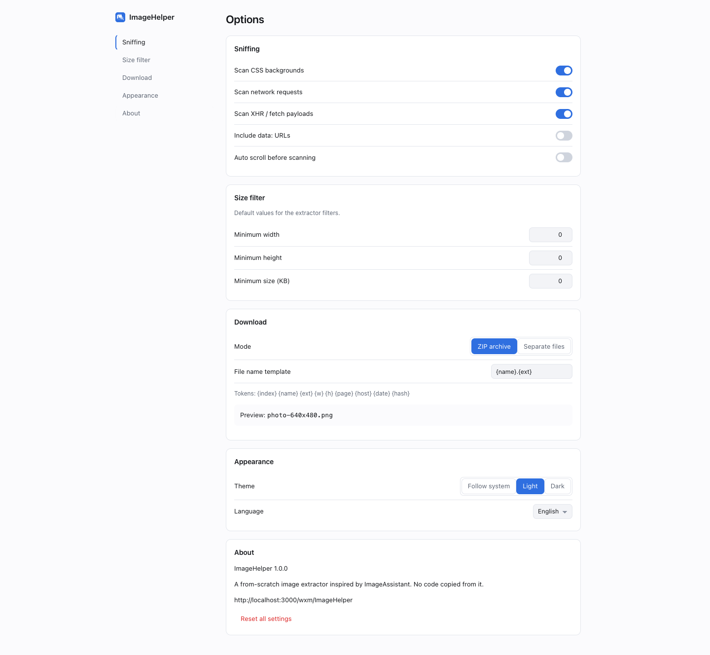

# ImageHelper

**English** · [简体中文](README_CN.md)

Extract, filter, preview, and batch download images from web pages in Chrome and Safari.

[Report an issue](https://github.com/wxmvv/ImageHelper/issues)
· [Development guide](docs/DEVELOPMENT.md)
· [Privacy policy](https://github.com/wxmvv/ImageHelper/wiki/Privacy-Policy)


## Features

- Find images in page markup, CSS backgrounds, lazy-loaded elements, Shadow DOM, and network activity.
- Filter by format, dimensions, file size, or URL. Sort the results, group visually similar images, and open a full-size preview.
- Download a selection as a ZIP archive or save images individually. Configure filenames and retry failed downloads.
- Extract images from multiple URLs and combine the results.
- Use English or Simplified Chinese, switch between light and dark themes, or enable a transparent toolbar popup.

|                                                        |                                                 |
| ------------------------------------------------------ | ----------------------------------------------- |
|            |         |
|  |  |

## Installation

### Chrome

From the repository root, install dependencies and build the extension.

```sh
npm ci
npm run build
```

Open `chrome://extensions`, enable **Developer mode**, choose **Load unpacked**, and select `dist/`.

### Safari on macOS

Install Xcode, then run these commands from the repository root.

```sh
npm ci
npm run safari:build
open safari/build/Build/Products/Debug/ImageHelper.app
```

Enable ImageHelper under **Safari → Settings → Extensions**. See the [development guide](docs/DEVELOPMENT.md#safari-on-macos) for signing and local debug builds.

## Bugs and feature requests

[Search existing issues](https://github.com/wxmvv/ImageHelper/issues?q=is%3Aissue), including closed ones, before [opening an issue](https://github.com/wxmvv/ImageHelper/issues/new). English and Simplified Chinese are both welcome.

For a bug, include the browser, operating system, and extension version, plus the steps to reproduce it and the expected and actual results. If it only affects a particular site, share a publicly accessible example. GitHub issues are public, so redact personal information, credentials, and private links from screenshots and logs.

## Development

See the [development guide](docs/DEVELOPMENT.md) for build, test, and debugging commands. The [architecture](docs/ARCHITECTURE.md) and [feature index](docs/FEATURES.md) describe the implementation in Chinese.

## Known limitations

- Sites that check cookies or referrers may reject image requests during ZIP downloads. Failed items can be retried from the results page.
- Extracting arbitrary `blob:` image URLs is unsupported, and some dynamically injected styles may be missed.

## License

[MIT](LICENSE)
