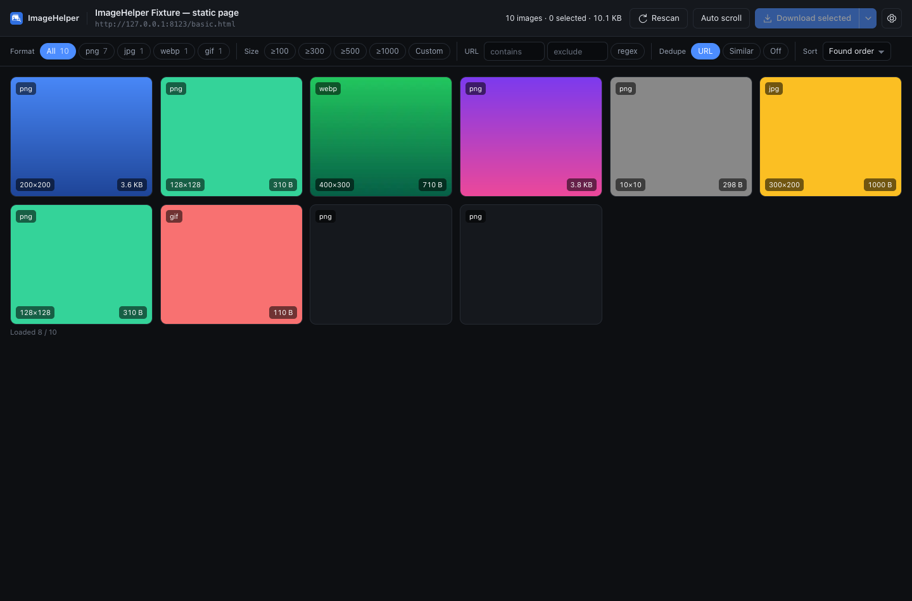
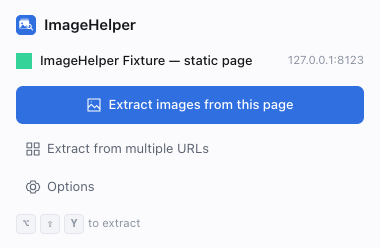

# ImageHelper

网页图片批量提取与下载扩展，支持 **Chrome (MV3)** 与 **Safari Web Extension**。



## 功能

- **多源嗅探**：DOM（`img` / `srcset` / `picture` / `svg image` / `video poster` / favicon / `og:image` / 图片链接 /
  Shadow DOM）、CSS（样式表 CSSOM + 计算样式 + 内联样式）、网络资源时间线、`fetch`/`XHR` 响应体中的图片地址。
- **懒加载**：一键自动滚动触发加载，滚动过程中持续嗅探。
- **筛选页**：格式、最小尺寸、URL 包含/排除（正则）、相似图去重（dHash）、排序；大图预览、范围选择、键盘操作。
- **批量下载**：自研 store 模式 ZIP（图片无需再压缩）、命名模板、并发抓取、失败重试、进度与取消。
- **多地址提取**：粘贴 URL 列表，后台逐个打开、提取、合并导出。
- 支持中英双语、明暗主题和可选的透明弹窗背景。

|                                             |                                            |
| ------------------------------------------- | ------------------------------------------ |
|         |    |
|  |  |

## 安装使用

### Chrome

```bash
npm install
npm run build
```

打开 `chrome://extensions` → 开启「开发者模式」→「加载已解压的扩展程序」→ 选择 `dist/`。

### Safari

```bash
npm run safari:build
open safari/build/Build/Products/Debug/ImageHelper.app
```

然后在 Safari 里：设置 → 高级 → 显示网页开发者功能；菜单「开发」→ 允许未签名的扩展；设置 → 扩展 → 勾选 ImageHelper。
详见 [docs/SAFARI.md](docs/SAFARI.md)，状态自检：`node tools/safari-verify.mjs`。

## 开发

```bash
npm run build        # → dist/（可直接加载）
npm run dev          # watch 模式
npm run check        # typecheck + lint + prettier + 单测
npm run e2e          # 真实 Chrome（For Testing）端到端
npm run ui:shots     # 生成 UI 截图到 .ref/shots/
node tools/smoke.mjs # 冒烟：加载 dist/ 看 manifest 是否报错
```

品牌版 Chrome 137+ 已忽略 `--load-extension`，测试脚本使用 Chrome for Testing：`npm run chrome:setup`。

## 目录

```
src/core/        纯逻辑（不碰 DOM / chrome）：类型、筛选、命名、ZIP、dHash、URL
src/platform/    chrome.* 适配层：storage / rpc / i18n / 下载落盘 / 主题
src/background/  服务工作线程：会话、注入、多地址编排、命令与右键菜单
src/content/     页面嗅探：DOM / CSSOM / 网络 / 懒加载 / MAIN world 钩子 / 自动滚动
src/pages/       extractor · popup · options · multiurl
src/ui/          设计令牌、基础组件、DOM 与图标工具
tools/           构建校验、fixture 站点、e2e、Safari 打包与自检
docs/            规划、架构、界面规范、功能索引、Safari 说明
```

细节见 [docs/ARCHITECTURE.md](docs/ARCHITECTURE.md)、[docs/FEATURES.md](docs/FEATURES.md)。

## 已知限制

- 防盗链站点（校验 Referer/Cookie）在 ZIP 抓取时可能失败，会进入失败列表并可重试。
- `blob:` 图片与 CSS-in-JS 动态注入的样式无法嗅探（浏览器不暴露来源）。

## 许可

未指定许可证前保留所有权利，仅供个人使用。
