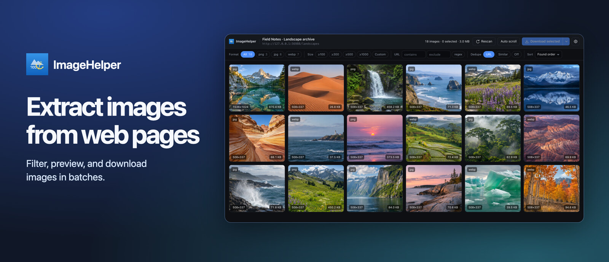
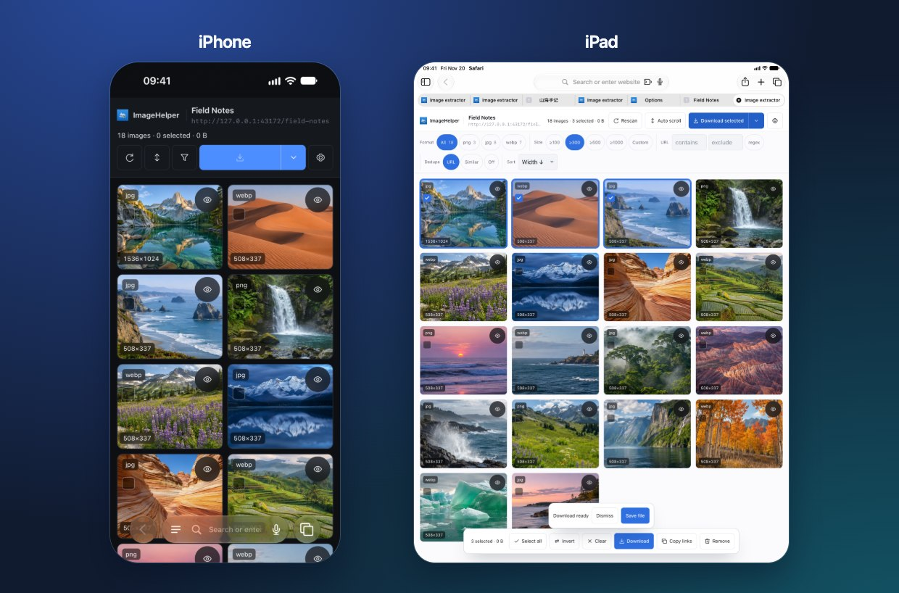

# ImageHelper

Extract, filter, and batch-download images from web pages in Chrome and Safari.

[简体中文](README_CN.md) · [Privacy](https://github.com/wxmvv/ImageHelper/wiki/Privacy-Policy) · [Report an issue](https://github.com/wxmvv/ImageHelper/issues)

## Features

- Find images in page content, CSS backgrounds, and lazy-loaded sections, or combine results from several URLs.
- Filter by size, format, or URL, group visually similar images, and preview at full size.
- Save selected images as a ZIP or individually. Customize filenames and retry failed downloads.

## Local installation

Run `npm ci` from the repository root, then follow the steps for your browser.

| Platform                 | Setup                                                                                                                                                                                  |
| ------------------------ | -------------------------------------------------------------------------------------------------------------------------------------------------------------------------------------- |
| Chrome                   | Run `npm run build`. At `chrome://extensions`, enable **Developer mode** and load `dist/` unpacked.                                                                                    |
| Safari on Mac            | Use Xcode and follow the [Safari build guide](docs/SAFARI.md). Turn on ImageHelper in **Safari → Settings → Extensions**.                                                              |
| Safari on iPhone or iPad | Build the **ImageHelper iOS** scheme using the [Safari build guide](docs/SAFARI.md#iphone-和-ipad). In Safari, open the page menu and turn on ImageHelper under **Manage Extensions**. |

## Development

[Build, test, and debug](docs/DEVELOPMENT.md) · [Feature reference](docs/FEATURES.md) · [MIT License](LICENSE)
