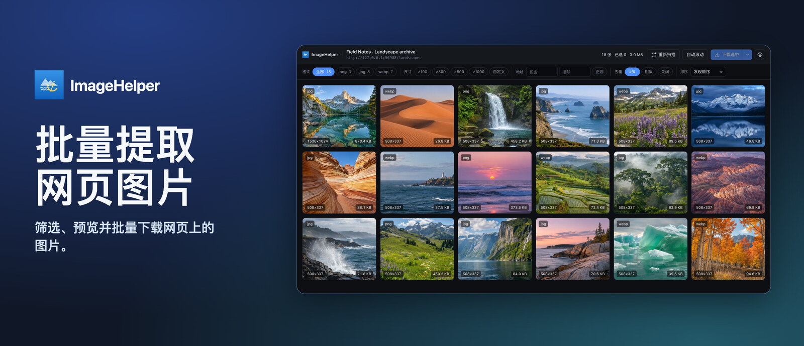
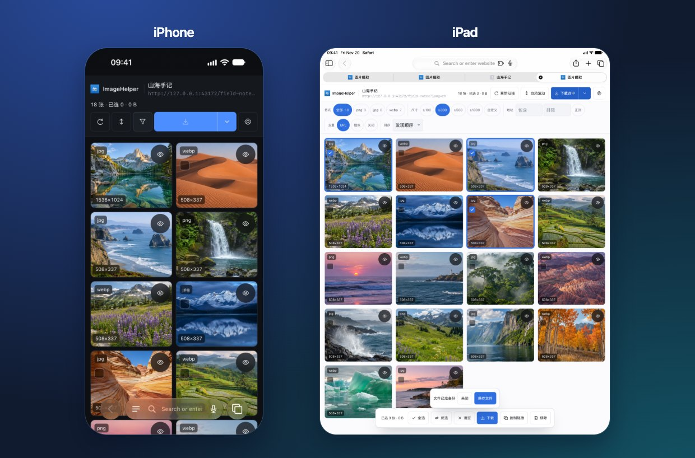

# ImageHelper

在 Chrome 和 Safari 中提取、筛选并批量下载网页图片。

[English](README.md) · [隐私政策](https://github.com/wxmvv/ImageHelper/wiki/%E9%9A%90%E7%A7%81%E6%94%BF%E7%AD%96) · [问题反馈](https://github.com/wxmvv/ImageHelper/issues)

## 功能

- 发现网页内容、CSS 背景和延迟加载的图片，并可合并从多个网址提取的结果。
- 按尺寸、格式或 URL 筛选，相似图片可分组，支持放大预览。
- 将选中的图片打包为 ZIP 或逐张保存，支持自定义文件名和重试失败项。

## 本地安装

在仓库根目录运行 `npm ci`，然后按平台安装。

| 平台                     | 安装方式                                                                                                                                       |
| ------------------------ | ---------------------------------------------------------------------------------------------------------------------------------------------- |
| Chrome                   | 运行 `npm run build`。在 `chrome://extensions` 开启「开发者模式」，加载 `dist/`。                                                              |
| Safari（Mac）            | 使用 Xcode，按 [Safari 构建说明](docs/SAFARI.md)构建。在 Safari 的「设置 → 扩展」中启用 ImageHelper。                                          |
| Safari（iPhone 或 iPad） | 按 [Safari 构建说明](docs/SAFARI.md#iphone-和-ipad)构建 **ImageHelper iOS** scheme。在 Safari 的页面菜单中选择「管理扩展」，开启 ImageHelper。 |

## 开发

[构建、测试与调试](docs/DEVELOPMENT_CN.md) · [功能索引](docs/FEATURES.md) · [MIT 许可证](LICENSE)
