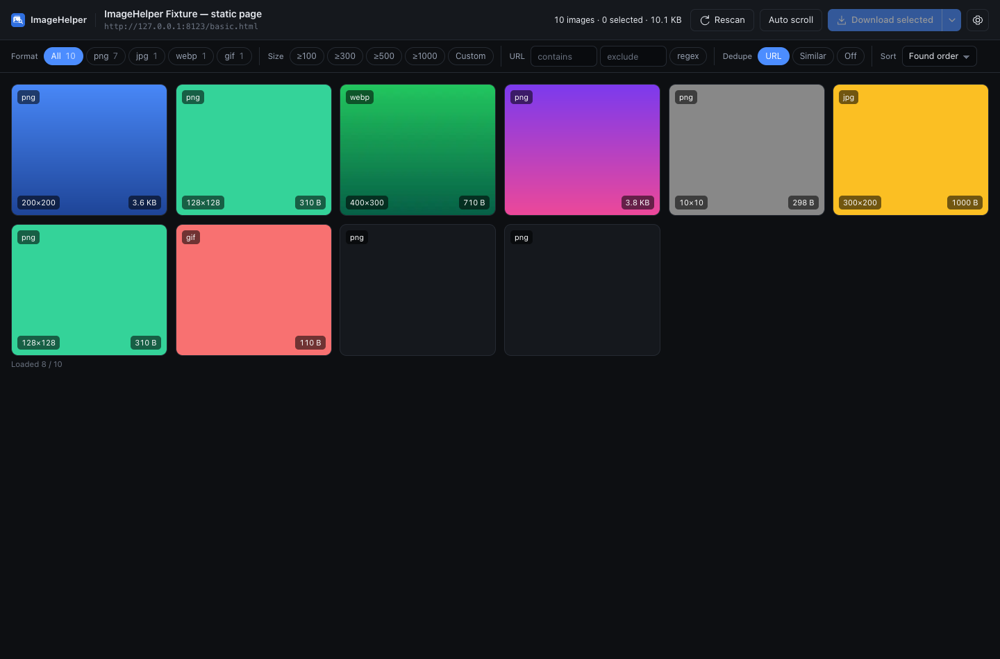
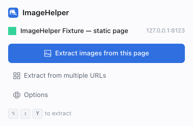
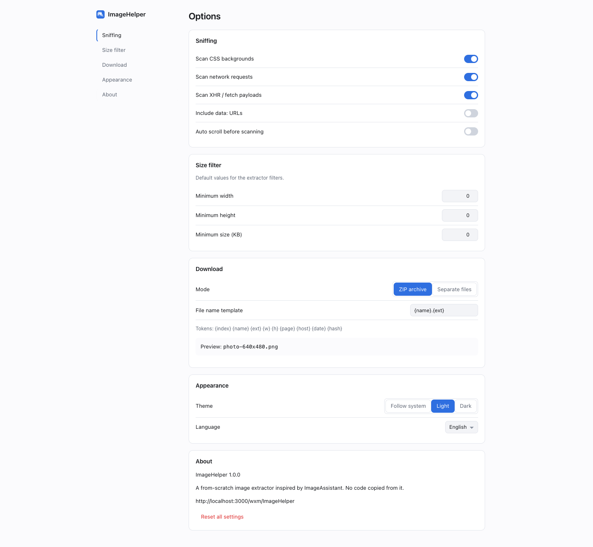
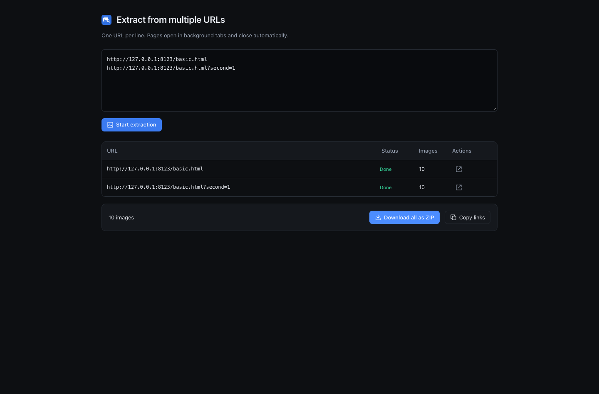
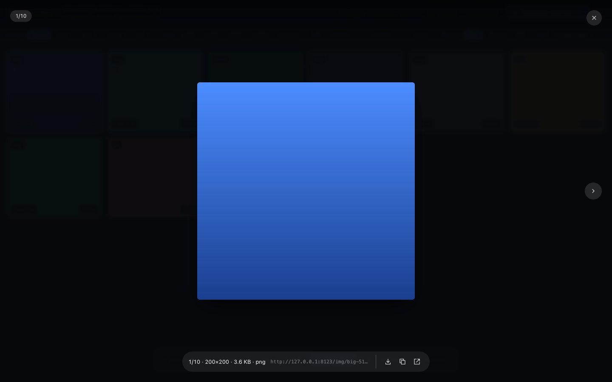

# ImageHelper

[English](README.md) · **简体中文**

网页图片批量提取与下载扩展，支持 **Chrome (MV3)** 与 **Safari Web Extension**。

[问题反馈](https://github.com/wxmvv/ImageHelper/issues)
· [开发与调试](docs/DEVELOPMENT_CN.md)
· [隐私政策](https://github.com/wxmvv/ImageHelper/wiki/%E9%9A%90%E7%A7%81%E6%94%BF%E7%AD%96)



## 功能

- **多源嗅探**：DOM（`img` / `srcset` / `picture` / `svg image` / `video poster` / favicon / `og:image` / 图片链接 /
  Shadow DOM）、CSS（样式表 CSSOM + 计算样式 + 内联样式）、网络资源时间线、`fetch`/`XHR` 响应体中的图片地址。
- **懒加载**：一键自动滚动触发加载，滚动过程中持续嗅探。
- **筛选页**：格式、最小尺寸、URL 包含/排除（正则）、相似图去重（dHash）、排序；大图预览、范围选择、键盘操作。
- **批量下载**：自研 store 模式 ZIP（图片无需再压缩）、命名模板、并发抓取、失败重试、进度与取消。
- **多地址提取**：粘贴 URL 列表，后台逐个打开、提取、合并导出。
- 支持中英双语、明暗主题和可选的透明弹窗背景。

|                                             |                                            |
| ------------------------------------------- | ------------------------------------------ |
|         |    |
|  |  |

## 安装使用

### Chrome

```bash
npm ci
npm run build
```

打开 `chrome://extensions` → 开启「开发者模式」→「加载已解压的扩展程序」→ 选择 `dist/`。

### Safari

在 macOS 上安装 Xcode 后，从仓库根目录运行以下命令。

```bash
npm ci
npm run safari:build
open safari/build/Build/Products/Debug/ImageHelper.app
```

打开 Safari 的「设置 → 扩展」，启用 ImageHelper。签名配置和本地开发构建的启用步骤见 [Safari 构建说明](docs/SAFARI.md)。

## 问题反馈

反馈前请先[搜索已有 Issue](https://github.com/wxmvv/ImageHelper/issues?q=is%3Aissue)，包括已关闭的问题。没有找到相关记录时，可以用中文或英文[提交 Issue](https://github.com/wxmvv/ImageHelper/issues/new)。

报告故障时，请附上浏览器、操作系统和扩展版本，以及复现步骤、预期和实际结果。如果问题只出现在某个网页，请提供可公开访问的示例。GitHub Issue 是公开的，请先从截图和日志中移除个人信息、登录凭据和私有链接。

## 开发

构建、测试和调试步骤见[开发指南](docs/DEVELOPMENT_CN.md)。实现细节见[架构说明](docs/ARCHITECTURE.md)和[功能索引](docs/FEATURES.md)。

## 已知限制

- 防盗链站点（校验 Referer/Cookie）在 ZIP 抓取时可能失败，会进入失败列表并可重试。
- `blob:` 图片与 CSS-in-JS 动态注入的样式无法嗅探（浏览器不暴露来源）。

## 许可

本项目采用 [MIT 许可证](LICENSE)。
